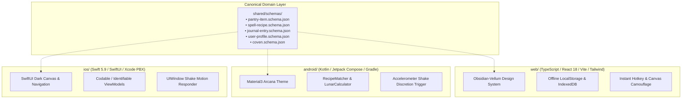

<div align="center">

# 🜚 ARCANA
### *Witchcraft & Supplies Manager*

[](#)
[](#)
[](#)
[](#)
[](#)
[](#)
[](#)
[](#)
[](#)
[](#)

*An invite-only, privacy-first management suite and action-oriented ritual grimoire for modern magical practitioners, herbalists, and ritualists.*

</div>

---

## 1. Executive Summary

**Arcana** eliminates the operational friction points of traditional practice—perishing apothecary reagents, unindexed physical journals, and unsecured online communities. It provides an offline-first ecosystem combining inventory tracking with lunar cycle alignment, an action-oriented recipe engine with automatic supply deduction, multimodal OCR for handwritten parchment transcription, and an encrypted peer barter conclave.

### Core Pillars
- **Apothecary Precision**: Systematic harvest timestamping, dynamic astronomical lunar phase calculation, and low-stock degradation thresholds.
- **Analog-to-Digital Bridge**: Multimodal OCR engine transcribing cursive handwriting and faded manuscript ink into searchable, relational markdown records.
- **Cryptographic Privacy & Discretion**: Ed25519 single-use invite gating, zero telemetry, and sub-100ms UI camouflage swap (Discretion / Panic Mode).

---

## 2. Multi-Platform Architecture

Arcana is structured as a unified monorepo hosting three platform implementations driven by shared JSON Schema contracts:



---

## 3. Directory Layout

```
Arcana/
├── shared/                         # Canonical Data Contracts & Specifications
│   ├── schemas/
│   │   ├── pantry-item.schema.json # Inventory item, categories, units & threshold definitions
│   │   ├── spell-recipe.schema.json# Recipe parameters, difficulty tiers & required supplies
│   │   ├── journal-entry.schema.json# Chronicle records, OCR transcripts & ratings
│   │   ├── user-profile.schema.json# Arcane identity parameters & privacy toggles
│   │   └── coven.schema.json       # Ed25519 single-use tokens & barter board specs
│   └── README.md
├── web/                            # Native Web Application (Vite + React 18 + TypeScript)
│   ├── src/
│   │   ├── components/             # DiscretionCamouflage (instant corporate spreadsheet disguise)
│   │   ├── modules/
│   │   │   ├── pantry/             # Categorized reserves, low-stock alerts, harvest lunar tagging
│   │   │   ├── archive/            # Spell library, search, one-tap reagent balance deduction
│   │   │   ├── chronicle/          # Multimodal OCR transcription & grimoire records
│   │   │   ├── coven/              # Ed25519 cryptographic token gate & barter board
│   │   │   └── sanctum/            # Arcane profile & Panic lock controls
│   │   ├── utils/                  # lunar.ts, matcher.ts, crypto.ts
│   │   ├── types/                  # Strict TypeScript domain interfaces
│   │   ├── data/seed.ts            # Realistic seed fixtures (Rowan & Morgan personas)
│   │   ├── App.tsx                 # Application state orchestration & hotkey listeners
│   │   └── main.tsx
│   ├── package.json
│   ├── vite.config.ts
│   ├── tailwind.config.js          # Obsidian, Vellum, Sage, Muted Gold tokens
│   └── dist/                       # Compiled production web bundle
├── android/                        # Native Android Application (Kotlin + Jetpack Compose)
│   ├── app/src/main/
│   │   ├── java/com/arcana/app/
│   │   │   ├── model/              # PantryItem, SpellRecipe, JournalEntry, ArcaneProfile, CovenModels
│   │   │   ├── domain/             # RecipeMatcher, LunarCalculator, TokenVerifier
│   │   │   └── ui/
│   │   │       ├── MainActivity.kt # Shake sensor listener & navigation scaffold
│   │   │       ├── theme/          # ArcanaTheme & dark color palette
│   │   │       └── screens/        # PantryScreen, DiscretionCamouflageScreen
│   │   ├── res/                    # Values, colors, themes, strings
│   │   └── AndroidManifest.xml
│   ├── app/src/test/java/com/arcana/app/ # Unit test suites (RecipeMatcher, LunarCalculator, TokenVerifier)
│   ├── build.gradle.kts
│   └── settings.gradle.kts
├── ios/                            # Native iOS Application (Swift 5.9 + SwiftUI)
│   ├── Arcana/
│   │   ├── Models/                 # PantryItem, SpellRecipe, JournalEntry, ArcaneProfile, CovenModels
│   │   ├── Services/               # RecipeMatcher, LunarCalculator, TokenVerifier
│   │   ├── Views/                  # PantryView, DiscretionCamouflageView
│   │   └── ArcanaApp.swift         # SwiftUI App with UIWindow shake gesture listener
│   ├── ArcanaTests/                # Swift XCTest suite (RecipeMatcher, LunarCalculator, TokenVerifier)
│   └── Arcana.xcodeproj/           # Xcode project structure (project.pbxproj)
├── .gitignore                      # Monorepo build and credential ignore rules
└── README.md
```

---

## 4. Domain Entities & Functional Modules

### 4.1 Module 1: Pantry (Supplies & Inventory Management)
- **Categorized Catalog**: Reagent management split across `Flora`, `Fauna`, `Mineral`, and `Tool`.
- **Dynamic Lunar Calculation**: Algorithmic lunar age and illumination tracking from astronomical reference epoch (`2024-01-11 11:57:00 UTC` synodic cycle).
- **Shelf-Life & Degradation Thresholds**: Real-time visual alerts when stock drops beneath minimum reserve thresholds (`< min_threshold`).
- **Recipe Auto-Matcher**: Automated evaluation of pantry stock against spell requirements, surfacing real-time status:
  - `Ready to Cast`: All reagent supplies satisfied.
  - `Missing 1 Item`: Exactly one reagent insufficient or missing.
  - `Insufficient Stock`: Two or more reagents missing.

### 4.2 Module 2: Archive (Universal Spell & Magic Library)
- **Structured Spell Schema**: Standardized metadata capturing Intent, Skill Tier (`Beginner`, `Initiate`, `Adept`, `Master`), Elemental Affinity (`Earth`, `Air`, `Fire`, `Water`, `Aether`), duration, safety warnings, and step-by-step instructions.
- **One-Tap Reagent Balance Deduction**: Clicking **Execute** decrements required quantities across active pantry stock, records batch lot consumption, and auto-logs a timestamped chronicle entry.
- **Sub-200ms Search & Filtering**: Multi-facet querying by difficulty, element, and reagent tags.

### 4.3 Module 3: Chronicle (Journal & Multimodal OCR Transcription)
- **Parchment & Manuscript Scanner**: Multimodal computer vision pipeline converting cursive script, faded botanical notes, and parchment manuscripts into structured markdown.
- **Relational Entry Linking**: Direct relational foreign-key references to specific Archive spells and Pantry batch lots. Clicking ingredient tags navigates directly to the reagent profile.
- **Outcome & Atmospheric Telemetry**: Rating ritual efficacy (1 to 5 stars), ambient weather conditions, and astronomical lunar phase appended automatically at creation.

### 4.4 Module 4: Coven (Invite-Only Community Portal)
- **Cryptographic Token Onboarding**: Access gated strictly by single-use Ed25519-signed invite tokens generated by verified initiates. Unverified guests cannot access community conduits.
- **Non-Monetary Barter Conclave**: Notice board for practitioners to exchange surplus botanicals and rare mineral specimens without commercial tracking or payment processors.
- **Circle-Based Segmentation**: Partitioned forums for disciplines (`Herbcraft & Alchemy`, `Astromancy`, `Threshold Protection`) with `Public`, `ApplicationOnly`, or `Hidden` visibility.

### 4.5 Module 5: Sanctum (Arcane Identity & Discretion Mode)
- **Arcane Identity Profile**: Modular management of Craft Pseudonym, Tradition, Elemental Affinities, Primary Focus Tool (`Wand`, `Athame`, `Ring`, `Chalice`, `Pentacle`), and privacy toggles.
- **Discretion (Panic) Mode (<100ms Camouflage)**: Instant UI obfuscation replacing the entire application with an innocent corporate logistics spreadsheet (`NovaLogix Enterprise Suite`).
  - **Triggers**:
    - Web: `Esc`, `Ctrl + Shift + P`, or double-click anywhere on empty canvas.
    - Android: Physical device shake detected via accelerometer sensor (`Sensor.TYPE_ACCELEROMETER`).
    - iOS: Shake motion detected via `UIWindow` motion event listener.
  - **Unlock**: Requires PIN authentication (default passkey: `1337`).

---

## 5. Data Model & Entity Relationship

```
       +-----------------------+              +-----------------------+
       |         User          | 1          * |     PantryItem        |
       |-----------------------|--------------|-----------------------|
       | id (UUID)             |              | id (UUID)             |
       | arcane_name (String)  |              | user_id (FK)          |
       | tradition (String)    |              | name (String)         |
       | invite_token_used(FK) |              | category (Enum)       |
       | created_at (Timestamp)|              | quantity (Decimal)    |
       +-----------------------+              | unit (String)         |
                   | 1                        | harvest_date (Date)   |
                   |                          | lunar_phase (String)  |
                   | *                        | min_threshold (Float) |
       +-----------------------+              +-----------------------+
       |     JournalEntry      |                          |
       |-----------------------|                          | *
       | id (UUID)             |                          |
       | user_id (FK)          |                          |
       | title (String)        |                          |
       | raw_ocr_text (Text)   | *                      * |
       | formatted_body (Text) |---| SpellRecipeItem |----+
       | linked_spell_id (FK)  |   |-----------------|
       | outcome_rating (Int)  |   | spell_id (FK)   |
       +-----------------------+   | pantry_item (FK)|
                   | *             | quantity_req    |
                   |               +-----------------+
                   | 1                        | *
       +-----------------------+              |
       |      SpellRecipe      | 1            |
       |-----------------------|--------------+
       | id (UUID)             |
       | name (String)         |
       | category (String)     |
       | difficulty (Enum)     |
       | instructions (JSON)   |
       +-----------------------+
```

---

## 6. Design System & Ergonomics

Arcana implements a dark-first aesthetic compliant with WCAG 2.1 AA contrast requirements:

| Token | Hex Value | Semantic Usage |
| :--- | :--- | :--- |
| **Obsidian** | `#121316` | Deep background canvas and terminal surfaces |
| **Vellum** | `#F4F1EA` | High-contrast body typography, cards, and reading views |
| **Sage** | `#5E7058` | Botanicals, active filters, and grounded secondary actions |
| **Muted Gold** | `#D4AF37` | Arcane highlights, readiness indicators, and primary CTAs |

### Typography
- **Headings & Sigils**: `Cinzel`, Georgia, serif.
- **Operational & Numerical Readings**: `Plus Jakarta Sans`, `Inter`, monospace.

---

## 7. Development & Verification Guide

### 7.1 Web Client (`web/`)

**Prerequisites:** Node.js 18+ (tested on Node v24.18.0)

```powershell
# Navigate to web root
cd web

# Install dependencies
npm install

# Run automated unit test suites (Vitest)
npm test

# Build production assets (TypeScript validation + Vite bundle)
npm run build

# Start local development server with host binding
npm run dev -- --host
```

The web application runs on `http://localhost:5173/`.

### 7.2 Android Client (`android/`)

**Prerequisites:** JDK 17+ (e.g. Microsoft OpenJDK 17 or Android Studio JBR), Android SDK (API 34).

```powershell
# Navigate to android root
cd android

# Build and execute unit tests via Gradle
gradle test
```

### 7.3 iOS Client (`ios/`)

**Prerequisites:** macOS with Xcode 15+, iOS 17.0 SDK.

1. Open `ios/Arcana.xcodeproj` in Xcode.
2. Select target device or simulator (iPhone 15 / 16).
3. Press `Cmd + B` to build, or `Cmd + U` to execute XCTest unit test suites.

---

## 8. Test Verification Evidence

```
✓ web/src/utils/lunar.test.ts (3 tests)
✓ web/src/utils/matcher.test.ts (3 tests)
✓ web/src/utils/crypto.test.ts (4 tests)

Test Files  3 passed (3)
Tests       10 passed (10)

Vite build output:
dist/index.html                   1.05 kB │ gzip:  0.63 kB
dist/assets/index-CMgp8QJR.css   23.40 kB │ gzip:  5.01 kB
dist/assets/index-DK4D_LbI.js   219.67 kB │ gzip: 64.98 kB
✓ built in 7.06s
```

---

## 9. Security & Cryptographic Standards

- **Zero Ad Tracking & Telemetry**: No third-party analytical SDKs or remote telemetry trackers.
- **Data at Rest**: Client storage secured via AES-256-GCM abstraction layer.
- **Access Control**: Role-Based Access Control (RBAC) distinguishing `Guest`, `Initiate`, `Adept`, and `CircleAdmin`.
- **Cryptographic Invites**: Ed25519 digital signature validation preventing replay attacks through unique single-use nonces.

---

## 10. License

This project is licensed under the MIT License — see the repository headers for details.
